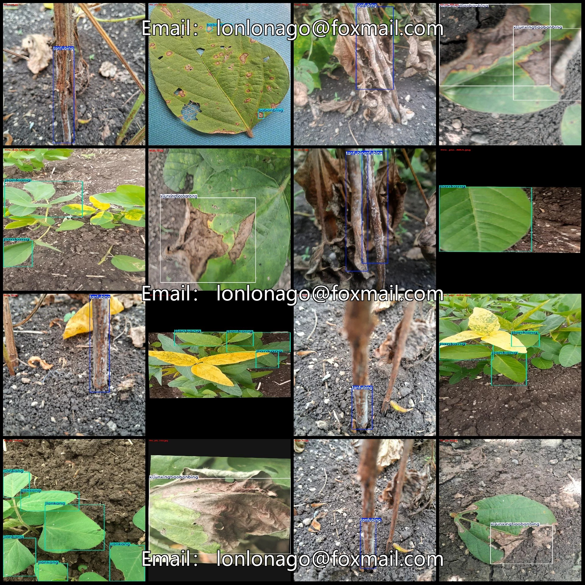
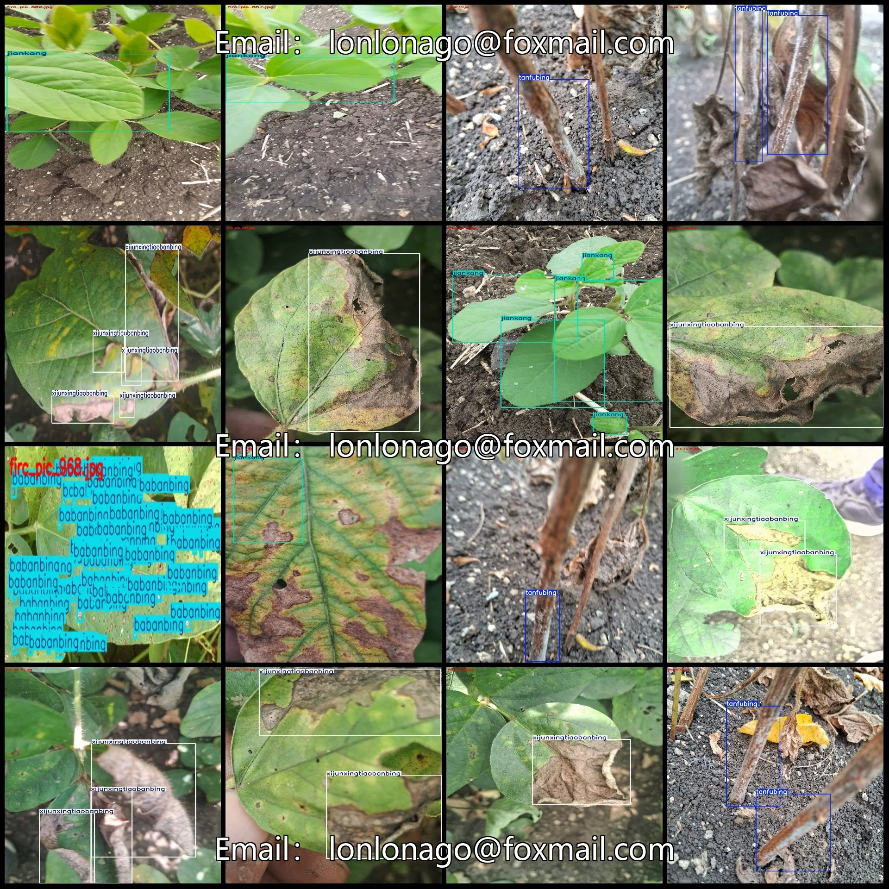
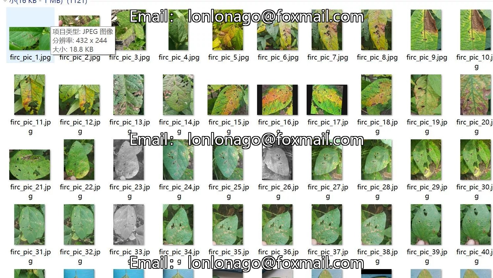
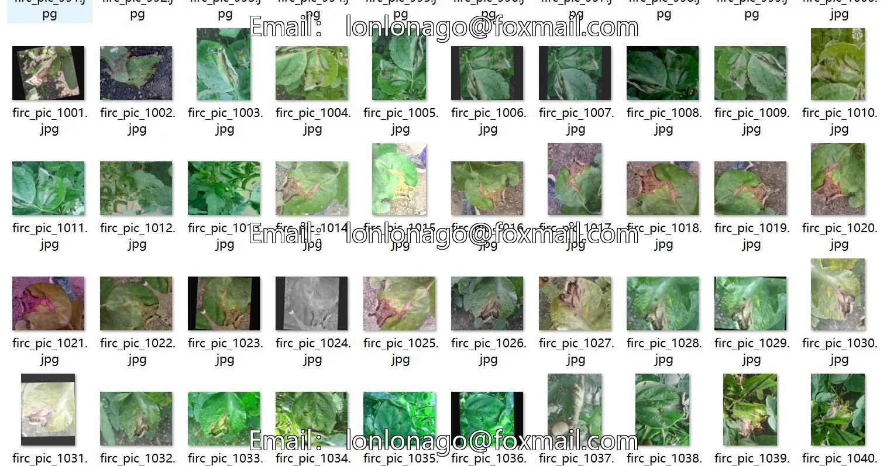
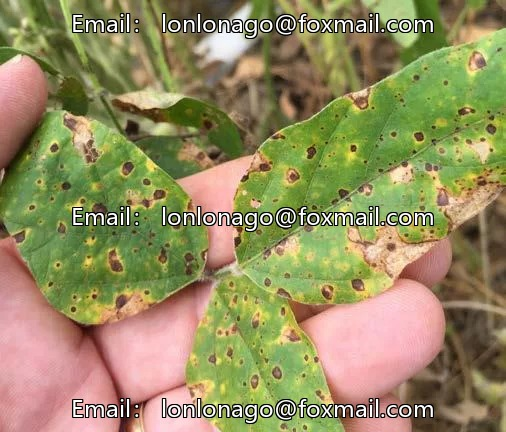
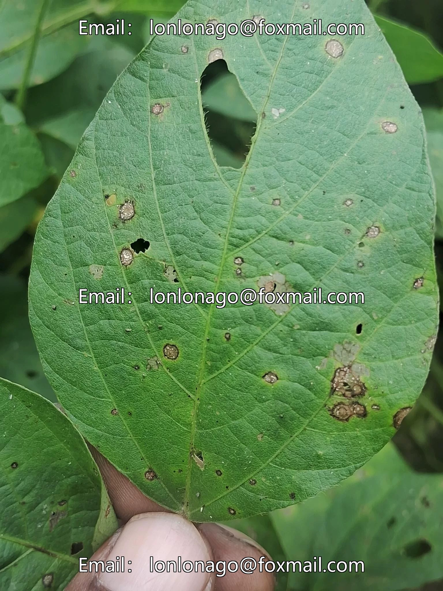
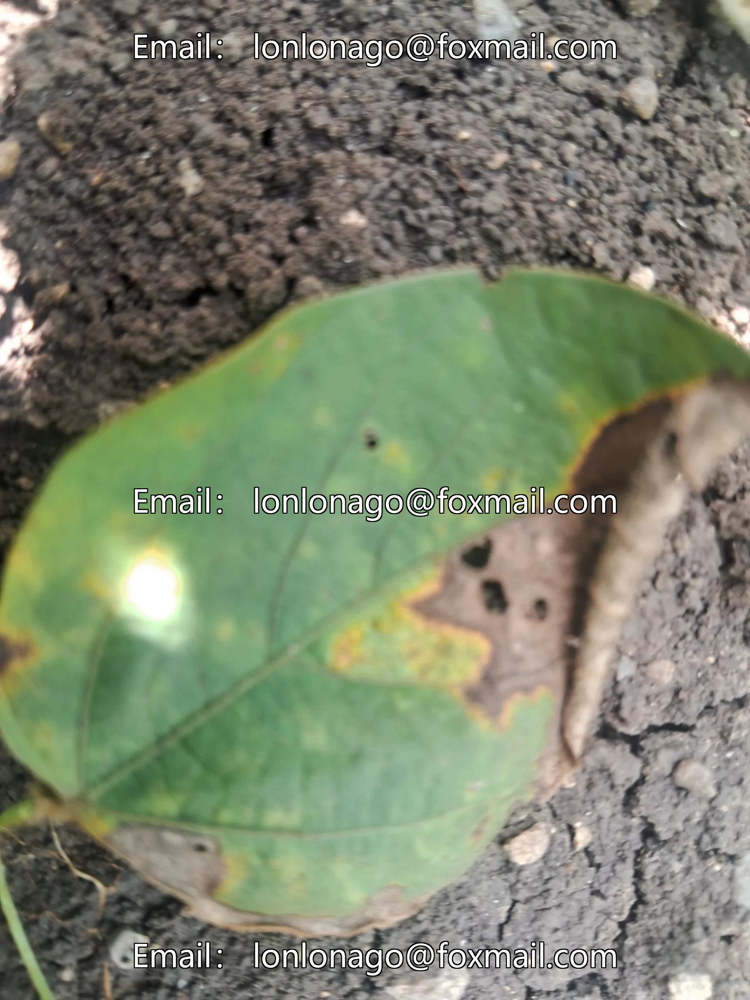

# Soybean leaf disease detection dataset VOC+YOLO format with 1121 images in 4 categories.

## Body

Soybean Leaf Disease Detection Dataset - VOC+YOLO format with 1121 images in 4 categories enhanced.

Note: Due to the dataset's replicability, please confirm compliance before purchasing.

Please be aware that some of the enhanced images are present in the dataset. Please review the images.

Dataset format: Pascal VOC format + YOLO format (txt file without segmentation paths, only containing jpg images and corresponding VOC format xml files and yolo format txt files)

Number of images (number of jpg files): 1121
Number of annotations (number of xml files): 1121
Number of annotations (number of txt files): 1121
Number of annotation categories: 4

Label category names (Note that the order of categories in the YOLO format does not correspond to this, but is based on the classes.txt file in the labels folder): ["babanbing", "jiankang", "tanfubing", "xijunxingtiaobanbing"]
["Target Spot Disease", "Health", "Carbon Rot Disease", "Bacterial Strip Disease"]
Number of boxes and the number of images occupied by each category
Babanbing frame count = 486, occupying image count = 37
Health Frames = 669, Pictures Taken = 359
Tanfubing frame count = 424, occupying image count = 288

Xijunxingtiaobanbing Frames = 882, Image Count = 439
Total Frames: 2461
Image Resolution: Multi-resolution images such as 2048x1536, 207x432, etc.
Labeling Tool: labelImg
Labeling Rules: Draw a rectangle around the category.
Important Notice: The dataset does not have separate training, validation, and test sets; you need to partition them yourself.
Special Remark: This dataset does not guarantee the accuracy of the trained models or weight files.

## Images

## Payment

Here is a pay link on Stripe ( https://buy.stripe.com/3cs8yP7sY87d0vu9AB ). Please contact me lonlonago@foxmail.com after funding $89, and I will send you a complete data files , thank you!

